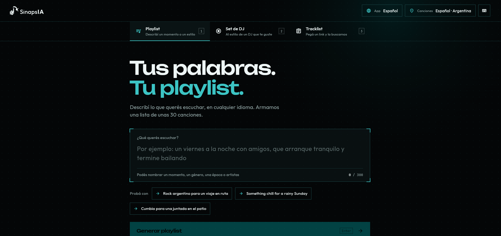
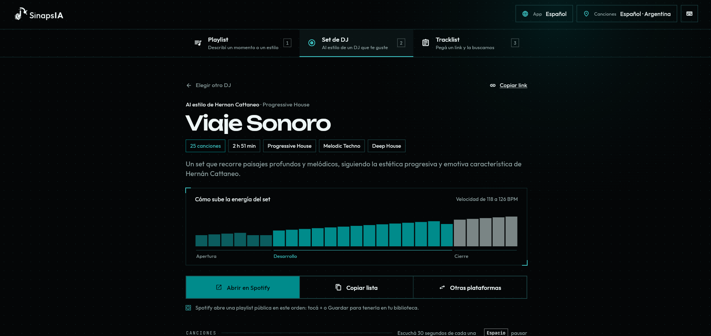
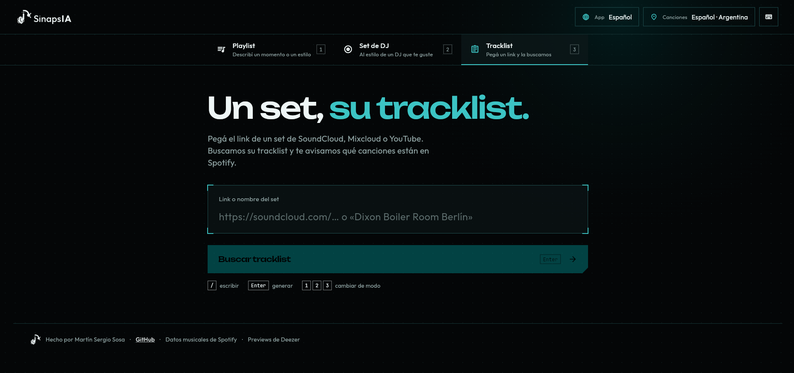
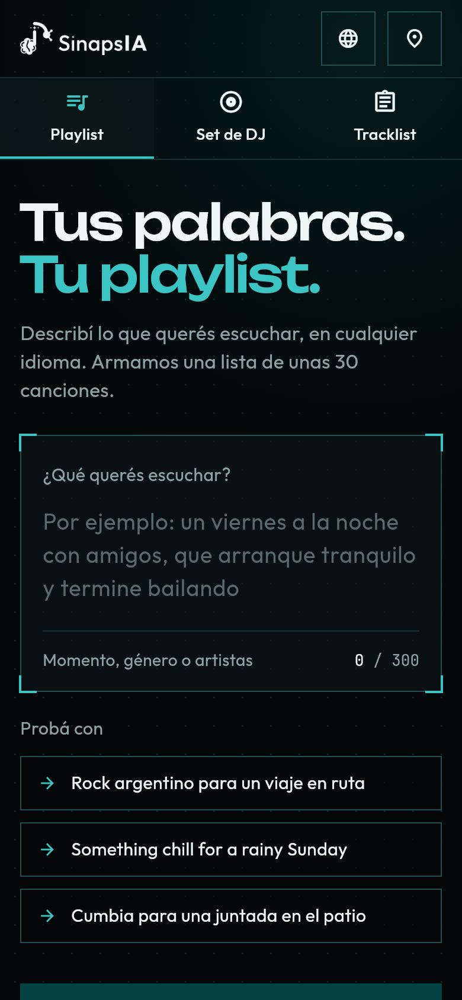
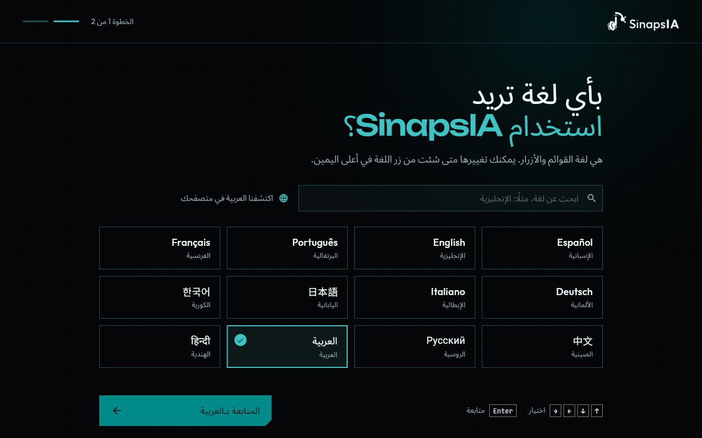
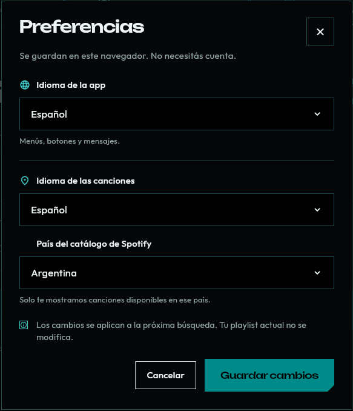

  <picture>
    <source media="(prefers-color-scheme: dark)" srcset="assets/brand/sinapsia-logo-light.svg">
    
  </picture>

  <strong>Tus palabras. Tu playlist.</strong> 
  Describí la música que querés escuchar, en cualquier idioma, y SinapsIA la arma por vos. 
  <em>Describe the music you want, in any language, and SinapsIA builds it for you.</em>

  <a href="https://sinapsia-web.onrender.com"><strong>→ Probar SinapsIA</strong></a>

  

> «Rock argentino para un viaje en ruta» · «Something chill for a rainy Sunday» · «雨の夜に聴くシティポップ»

## Tres formas de encontrar música

### Playlist: de una frase a 30 canciones

Escribí un momento, un estilo o un recuerdo, como hablarías con un amigo. SinapsIA entiende el pedido, elige las
canciones y te devuelve una lista lista para escuchar: con título, duración, géneros y años.

- **Música de tu lugar, en tu idioma.** Elegís en qué idioma preferís las canciones y de qué país es tu catálogo. Un
  «algo para correr» en Argentina suena distinto que en Brasil o en Japón.
- **Sugerencias de varias plataformas a la vez**, sin canciones repetidas y sin temas inventados: todo lo que ves se
  puede escuchar.
- **Ajustá con un toque**: más tranquila, más bailable, más nueva o más clásica, sin volver a escribir.
- **¿No te convence un tema?** Cambialo por otro parecido.

### Set de DJ: un set nuevo, con el estilo de quien te gusta

Elegí un DJ y una duración. SinapsIA arma un set original —no copia sus sets— ordenado en apertura, desarrollo y
cierre, con el BPM de cada tema y un gráfico de cómo sube la energía.

  

### Tracklist: el set que escuchaste, en tu biblioteca

Pegá el link de un set de SoundCloud, Mixcloud o YouTube. SinapsIA encuentra su tracklist, te dice cuántas
canciones están en Spotify y te deja buscar el resto en YouTube. Si todavía nadie la publicó, la vuelve a buscar
cada vez que entrás, durante dos semanas.

  

## Hecha para cualquiera

- **Sin cuentas ni login.** Abrís la página y la usás.
- **Previews de 30 segundos** de cada canción, uno detrás del otro con la escucha continua.
- **A Spotify con un toque**, aunque no tengas la app conectada: se abre una playlist pública y la guardás en tu
  biblioteca. También podés copiar la lista y pasarla a YouTube Music, Apple Music, Deezer, Tidal o Amazon Music.
- **Compartí lo que encontraste**: cada resultado tiene su link y quien lo abre ve la misma lista.
- **12 idiomas**: español, inglés, portugués, francés, italiano, alemán, japonés, coreano, chino, ruso, árabe (de
  derecha a izquierda) e hindi.
- **En la compu y en el celular**, con atajos de teclado para ir más rápido (`?` los muestra todos).

  
  &nbsp;&nbsp;
  

  

> La demo corre en servidores gratuitos que se apagan cuando nadie los usa: la primera búsqueda del día puede tardar
> hasta dos minutos. Después, todo va rápido.

## Hecha con

Flutter Web · Kotlin (Ktor) · Python (FastAPI) · Docker · Render

## Autor

Martín Sergio Sosa · [GitHub](https://github.com/martinsosa42)
